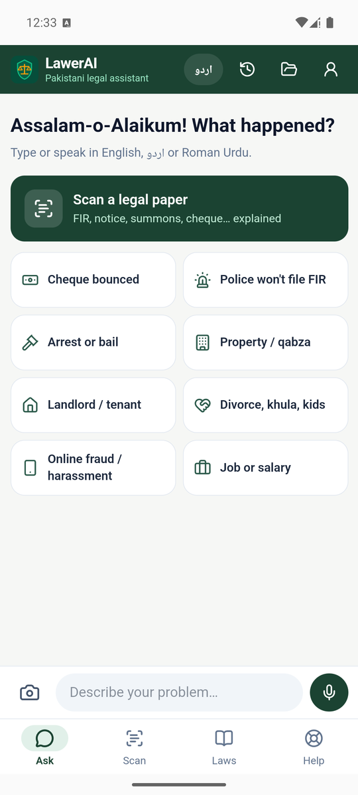
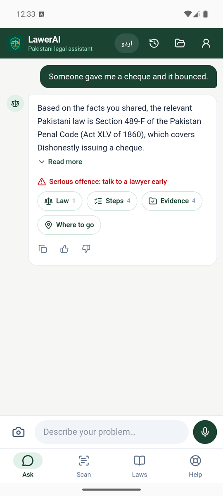

<h1 align="center">LawerAI · قانون معاون</h1>

<b>Your Pakistani legal assistant, in English, اردو and Roman Urdu</b> 
Made by <b>Maverick Tech Ventures</b>

---

Tell LawerAI what happened, in your own words, by typing or speaking.
It tells you which Pakistani law applies, what to do next, what evidence to keep and where to go.
Photograph an FIR, legal notice or court summons and it explains it in plain language,
including handwritten Urdu.

> LawerAI gives legal **information**, not a lawyer's advice. For a court case, talk to an advocate.
> In danger right now? Call **15**.

  
  &nbsp;&nbsp;
  

## ⬇️ Download

**[Download LawerAI-v1.1.0.apk](../../releases/latest)** from the Releases page (19.6 MB),
or take [`LawerAI-v1.1.0.apk`](LawerAI-v1.1.0.apk) from this repository.

### Install on Android
1. Download the APK on the phone, or send it over WhatsApp, USB or Google Drive.
2. Tap the file. If Android asks, allow **Install unknown apps** for your browser or file app.
3. Open **LawerAI** and tap a topic or type your problem.

Needs Android 7.0 or newer and an internet connection.
Without internet it still gives a short answer from the law library inside the app.

## ⚖️ What it does

| | Feature | |
|---|---|---|
| 💬 | **Ask** | Describe your problem. You get a short answer that names the exact law, with tap-to-open steps, evidence checklist, deadlines and where to go |
| 🎤 | **Speak** | Tap the mic and talk in Urdu or English (uses Google voice typing on the phone) |
| 📷 | **Scan** | Photograph an FIR, cheque memo, legal notice, summons or nikahnama. AI reads printed or handwritten Urdu and English and explains it |
| 📚 | **Laws** | Search sections of the PPC, CrPC, family, rent, labour, cyber-crime and other laws |
| 🆘 | **Help** | One-tap police call, women's, children's and cyber-crime helplines, free legal aid and lawyers |
| 🗂️ | **Case file** | Your facts, documents and deadlines in one place; sign in to keep them on any phone |

### One-tap topics
Cheque bounced · Police won't file FIR · Arrest or bail · Property / qabza ·
Landlord / tenant · Divorce, khula, kids · Online fraud / harassment · Job or salary

## 🔒 Privacy
- Nothing you type or photograph is sent until you press Send or Analyze.
- Photos are read by the LawerAI server and are **not stored** unless you add them to your case file.
- Case data is encrypted on the server.

## What's new in v1.1.0
- New phone-first design: one chat screen, short answers, bottom tabs
- Opens in a few seconds (was very slow before)
- Online answers, working sign-in
- Voice typing in Urdu and English
- Phone camera for documents, with AI reading of Urdu FIRs, including handwriting
